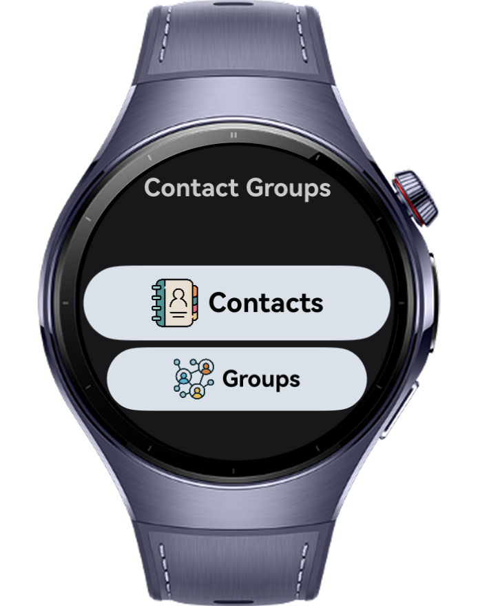
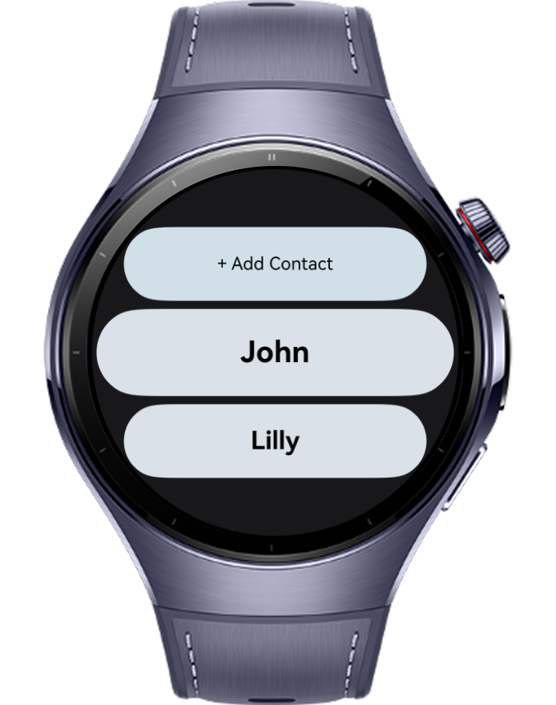
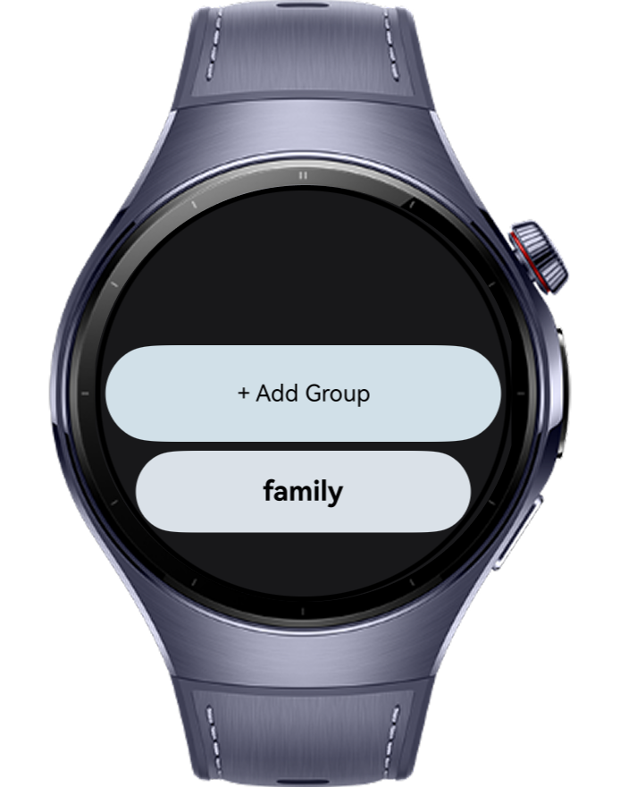
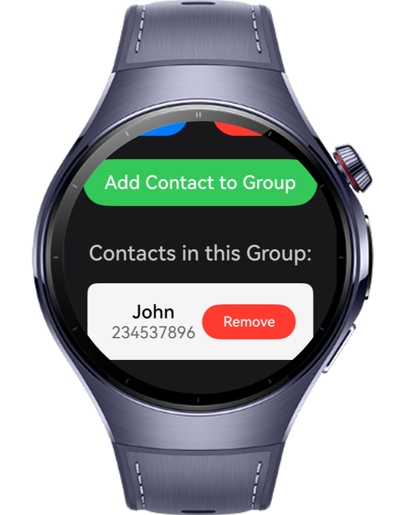

> **Note:** To access all shared projects, get information about environment setup, and view other guides, please visit [Explore-In-HMOS-Wearable Index](https://github.com/Explore-In-HMOS-Wearable/hmos-index).

# How to Use Contact Kit to Create Contact Groups

Contact Groups is a codelab project that users can manage their contacts, easily create new groups through the app, organize those contacts into groups, and manage the groups as well.

# Preview

<div>    
  
  
  
  
</div> 

# Use Cases

- Users can add contacts through the app.
- Users can update or delete their contacts whenever needed.
- Users can create groups to include their contacts, and they can also update or delete these groups.

# Technology

## Stack

- **Languages**: ArkTS
- **Frameworks**: HarmonyOS SDK 5.1.0(18)
- **Tools**: DevEco Studio Vers 5.1.0.842
- **Libraries**: @kit.ArkUI, @kit.ContactsKit, @ohos.data.relationalStore, @kit.AbilityKit,@kit.BasicServicesKit


## Required Permissions

- `ohos.permission.WRITE_CONTACTS`
  > Required to save new contacts by using contact kit.
- `ohos.permission.READ_CONTACTS`
  > Required to read/get contacts by using contact kit.

# Directory Structure

````
src
    ├───main
    │   │   module.json5
    │   │
    │   ├───ets
    │   │   ├───entryability
    │   │   │       EntryAbility.ets
    │   │   │
    │   │   ├───entrybackupability
    │   │   │       EntryBackupAbility.ets
    │   │   │
    │   │   ├───pages
    │   │   │       AddContactPage.ets
    │   │   │       AddGroupPage.ets
    │   │   │       ContactPage.ets
    │   │   │       ContactsPage.ets
    │   │   │       GroupPage.ets
    │   │   │       GroupsPage.ets
    │   │   │       Index.ets
    │   │   │
    │   │   ├───types
    │   │   │       Contact.ets
    │   │   │       Group.ets
    │   │   │       MainMenuItem.ets
    │   │   │
    │   │   ├───utils
    │   │   │       ContactUtils.ets
    │   │   │       GroupsUtils.ets
    │   │   │
    │   │   └───viewmodel
    │   │           MainMenuItems.ets
    │   │
    │   └───resources
    │       ├───base
    │       │   ├───element
    │       │   │       color.json
    │       │   │       float.json
    │       │   │       string.json
    │       │   │
    │       │   ├───media
    │       │   │       background.png
    │       │   │       contacts.png
    │       │   │       foreground.png
    │       │   │       groups.png
    │       │   │       layered_image.json
    │       │   │       startIcon.png
    │       │   │
    │       │   └───profile
    │       │           backup_config.json
    │       │           main_pages.json
    │       │           
    │       ├───dark
    │       │   └───element
    │       │           color.json
    │       │
    │       └───rawfile
   
````

# Constraints and Restrictions

## Suported Devices

- Huawei Watch 5

# LICENSE

Contact Groups is distributed under the terms of the MIT License.
See the [LICENSE](/LICENSE) for more information.

